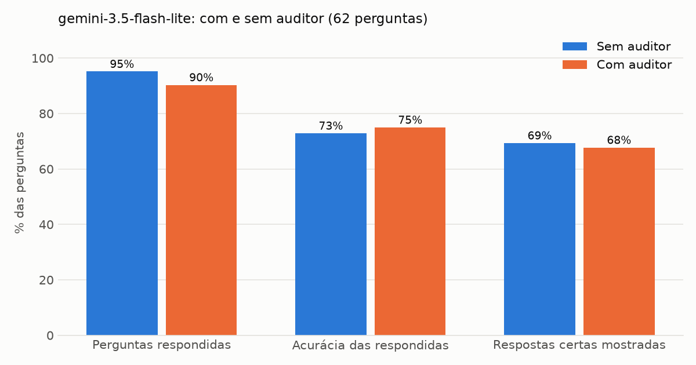
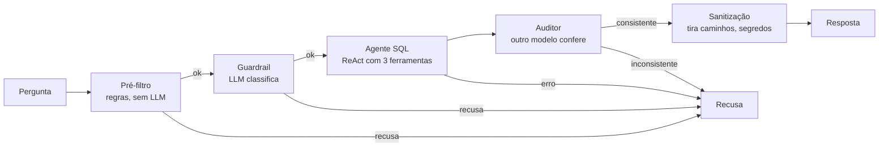

# text2sql-agent-evals

> **EN summary.** A study project: a text-to-SQL agent (LangGraph + Gemini) with guardrails and an
> LLM-as-judge, evaluated on 62 questions from the BIRD Mini-Dev benchmark (of a 100-question sample; the
> free API quota ran out). The goal is not a high score but to measure, with numbers, what each safety layer
> costs and what it buys. Main result: the agent got **71%** right (execution accuracy), but the small judge
> model caught only **2 of the 16** wrong answers it reviewed, while adding ~6 s and ~1.6k tokens per question.

Projeto de estudo. No trabalho eu mantenho um assistente que consulta banco de dados a partir de perguntas
em linguagem natural, e queria responder com números uma dúvida que aparece no dia a dia: **vale a pena ter
um "auditor" (um segundo LLM que confere a resposta antes de mostrar)?** Ele barra respostas erradas, mas
também barra respostas certas e deixa tudo mais lento e caro.

Para medir isso fora do trabalho, montei um agente parecido do zero, com dados públicos, e rodei um eval.

## Resultado

**62 perguntas** (52 *challenging*), agente `gemini-3.5-flash-lite`, auditor `gemini-3.1-flash-lite`.
O agente acertou **71%** (execution accuracy).

| Cenário | Respondidas | Acurácia das respondidas | Respostas certas mostradas |
|---|---|---|---|
| Sem auditor | 95% | 73% | 69% |
| Com auditor | 90% | 75% | 68% |



**O auditor, neste tamanho de modelo, quase não se paga:**

| | Resposta errada | Resposta certa |
|---|---|---|
| Auditor barrou | 2 | 1 (barrou à toa) |
| Auditor deixou passar | 14 | 42 |

- Pegou **2 de 16** respostas erradas (recall de 12%) e jogou fora 1 certa.
- Custo: +1 chamada de LLM, ~1,6 mil tokens (~4% do total) e ~6 s (~10% da latência) por pergunta.
- Quem gasta é o agente: ~8,8 chamadas e ~36 mil tokens por pergunta; latência p50 de 60 s e p95 de 104 s.

A próxima pergunta do estudo é se um auditor mais forte muda esse quadro, ou se vale mais gastar o mesmo
orçamento em outra coisa (por exemplo, deixar o agente conferir o próprio resultado).

Detalhes, incluindo acerto por dificuldade e custo por etapa, em [results/REPORT.md](results/REPORT.md).

## Como funciona



| Etapa | O que faz | Por quê |
|---|---|---|
| Pré-filtro | Recusa pergunta vazia, gigante ou com caracteres de controle | Barreira barata, sem custo de LLM |
| Guardrail | Um LLM classifica a pergunta (`ok`, `prompt_injection`, `write_request`, `system_extraction`, `off_topic`) | Se o guardrail falhar, a pergunta é bloqueada (*fail-closed*) |
| Agente | `list_tables`, `get_schema`, `run_query`; até 15 chamadas de ferramenta | O banco abre **somente leitura**, só aceita um `SELECT`/`WITH` por vez, consultas param em 20 s e o agente vê no máximo 50 linhas |
| Auditor | Outro modelo recebe a pergunta, as últimas consultas, os resultados e a resposta, e diz se a resposta é sustentada pelos dados | Quem responde não é quem julga |
| Sanitização | Remove tracebacks, caminhos de arquivo, connection strings e `chave=valor` com cara de segredo | Última barreira antes do usuário |

## Como o eval mede

- **Base:** [BIRD Mini-Dev](https://bird-bench.github.io/), versão de 2026 publicada no Hugging Face
  (`birdsql/bird_mini_dev`, SQLite), com as respostas esperadas corrigidas. Amostra de **100 perguntas**,
  sorteadas com semente fixa e proporcionais ao tamanho de cada banco ([evals/make_sample.py](evals/make_sample.py)).
  Essa versão é difícil: 88 das 100 são *challenging*. **Até agora rodaram 62**: a cota gratuita do agente é
  de 500 chamadas por dia (~40 perguntas). O runner retoma de onde parou; o resultado será atualizado.
- **Acerto (execution accuracy, EX):** executo o SQL do agente e o SQL esperado, e comparo os conjuntos de linhas.
- **Com e sem auditor numa rodada só:** o agente roda uma vez por pergunta; o relatório calcula os dois
  cenários a partir do mesmo resultado, então a diferença é só o efeito do auditor.
- **Auditor como classificador:** quantas respostas erradas ele barrou (acerto), quantas certas barrou à toa
  e quantas erradas deixou passar, com precisão e recall.
- **Custo:** tokens, chamadas de LLM e segundos por etapa; latência p50/p95 por pergunta.
- **Cota da API:** o script é retomável. Se a cota acabar, ele para sem gravar o erro como resposta errada e
  continua de onde parou na próxima execução.

Modelos usados: agente e guardrail `gemini-3.5-flash-lite`, auditor `gemini-3.1-flash-lite` (cota gratuita
do Google AI Studio). Os modelos ficam no `.env`, então dá para trocar por outro provedor do LangChain.

## O que aprendi no caminho

- No primeiro teste com 10 perguntas, o **pré-filtro barrou uma pergunta legítima** de ~1.200 caracteres
  (o limite era 1.000). A versão 2026 do BIRD tem perguntas longas; subi o limite para 3.000. É o tipo de
  falso positivo que só aparece rodando com dados reais.
- O auditor começou como `gemini-3.5-flash`, mas a cota gratuita dele é de 20 chamadas por dia: a rodada
  parou na pergunta 23. Troquei por `gemini-3.1-flash-lite` (outro modelo, cota maior) e **recomecei do zero**,
  para todas as perguntas serem julgadas pelo mesmo auditor. Escolher modelo também é escolher cota.
- Não ajustei os prompts olhando as perguntas da amostra: isso deixaria o número bonito e sem valor.
- O runner tratava qualquer erro 429 como "cota do dia acabou" e parava. Mas boa parte era o limite **por
  minuto**: agora ele espera 2 minutos e tenta de novo antes de desistir.
- A camada que eu imaginava ser a mais importante (o auditor) foi a que menos mudou o resultado. Sem medir,
  eu teria mantido ela por intuição.

## Limitações

- 62 perguntas é pouco: diferenças de poucos pontos percentuais (como 73% → 75%) podem ser ruído.
- Um único provedor e uma única rodada (temperatura 0, mas o modelo não é totalmente determinístico).
- O auditor é um modelo "lite", escolhido pela cota gratuita; um auditor mais forte pode mudar o resultado.
- O guardrail ainda não foi testado com um conjunto de ataques; nas perguntas do BIRD ele só mostra se
  bloqueia perguntas legítimas à toa.
- A comparação de linhas ignora ordem e duplicatas, como no EX oficial do BIRD.

## Como rodar

Precisa de [uv](https://docs.astral.sh/uv/) e de uma chave do [Google AI Studio](https://aistudio.google.com/apikey).

```bash
uv sync
cp .env.example .env        # e cole sua chave em GOOGLE_API_KEY
uv run python -m evals.download_bird        # baixa os bancos do BIRD Mini-Dev (~1,4 GB) para data/
uv run python -m text2sql_agent.ask --db superhero "How many superheroes have blue eyes?"
uv run python -m evals.run_eval --out results/gemini-3.5-flash-lite.jsonl --limit 10
uv run python -m evals.report results/gemini-3.5-flash-lite.jsonl
uv run pytest
```

## Estrutura

```
text2sql_agent/   pipeline (pré-filtro, guardrail, agente, auditor, sanitização) e prompts
evals/            download do BIRD, amostra, runner, métricas e relatório
results/          saída de cada rodada (.jsonl), REPORT.md e gráficos
tests/            testes das partes que não chamam LLM (rodam no CI)
```

## Créditos

Perguntas e bancos do [BIRD](https://bird-bench.github.io/) (Li et al., 2023), licença
[CC BY-SA 4.0](https://creativecommons.org/licenses/by-sa/4.0/). Os arquivos em `results/` contêm perguntas
e SQLs esperados do BIRD e seguem a mesma licença. Os bancos não são redistribuídos aqui.
