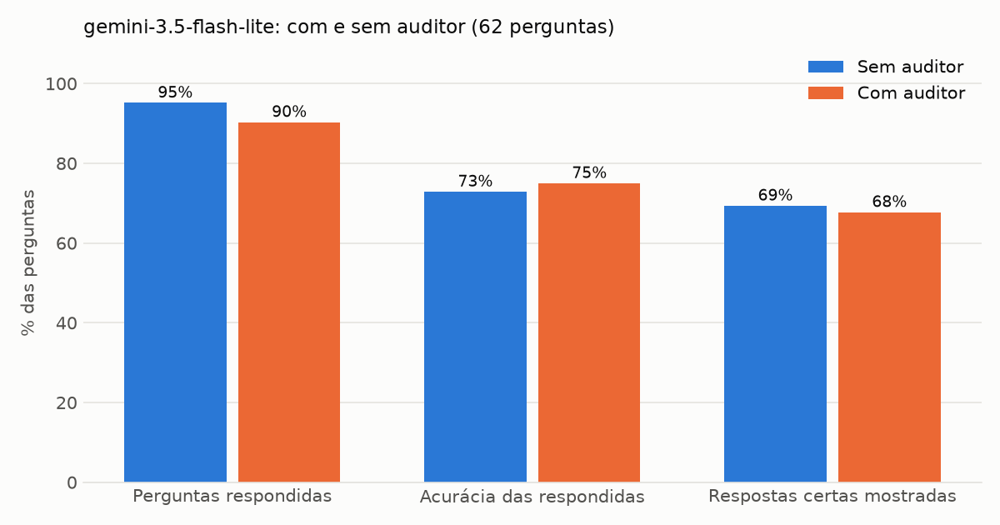

# Resultados

## gemini-3.5-flash-lite

Agente: `google_genai:gemini-3.5-flash-lite` · Guardrail: `google_genai:gemini-3.5-flash-lite` · Auditor: `google_genai:gemini-3.1-flash-lite` · 62 perguntas

**Execution accuracy (EX) geral: 71%**

| Cenário | Respondidas | Acurácia das respondidas | Respostas certas mostradas |
|---|---|---|---|
| Sem auditor | 95% | 73% | 69% |
| Com auditor | 90% | 75% | 68% |

Auditor como classificador (positivo = barrou a resposta):

| | Resposta errada (EX) | Resposta certa (EX) |
|---|---|---|
| Barrou | 2 (acerto do auditor) | 1 (barrou à toa) |
| Deixou passar | 14 (erro que passou) | 42 |

Precisão do auditor: 67% · Recall: 12%

EX por dificuldade: simple 100% (n=3) · moderate 71% (n=7) · challenging 69% (n=52)

| Etapa | Chamadas de LLM (média) | Tokens (média) | Segundos (média) |
|---|---|---|---|
| guardrail | 1.0 | 375 | 5.0 |
| agent | 8.8 | 35,758 | 52.0 |
| judge | 1.0 | 1,649 | 5.8 |

Por pergunta: 37,703 tokens em média · latência p50 60s, p95 104s

Status: agent_error 3 · answered 56 · rejected_by_judge 3

